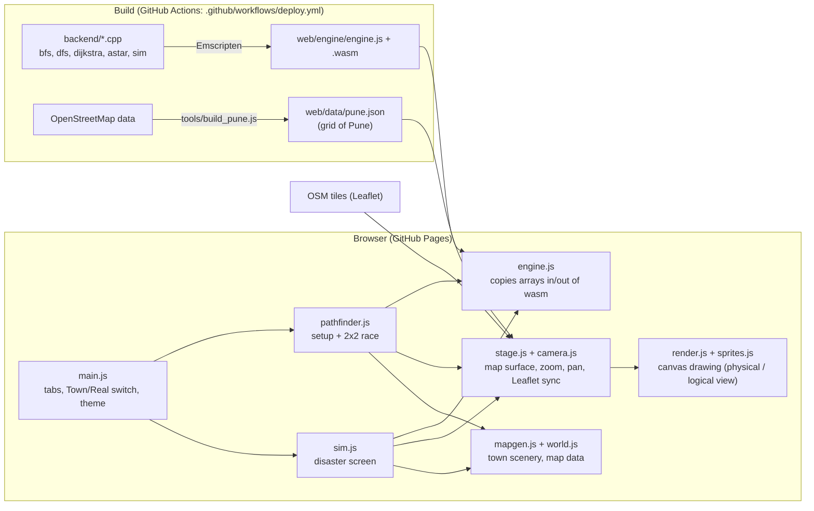
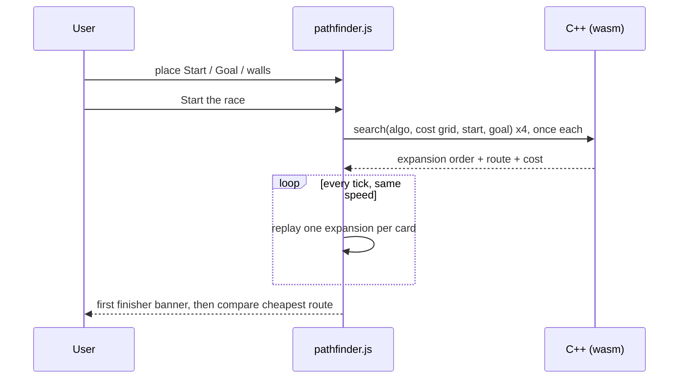
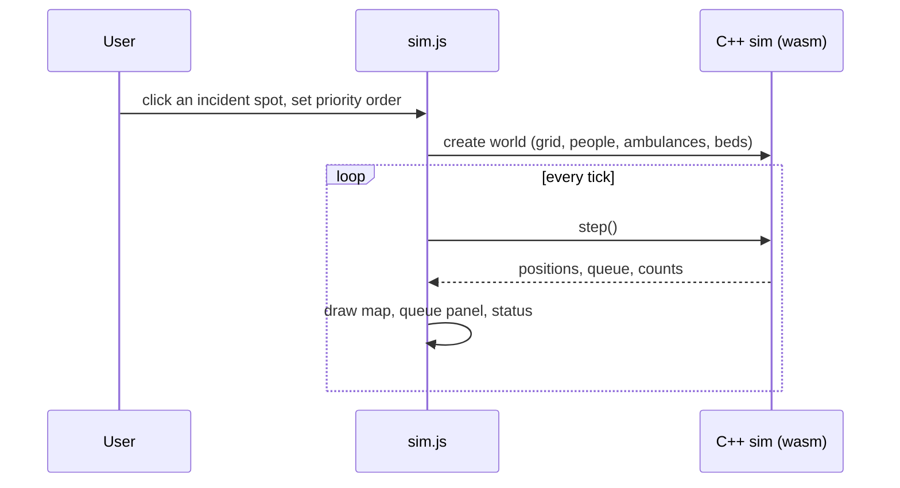

# Architecture

All the algorithms are C++ (`backend/`). The browser (`web/`) only draws and handles clicks.
The C++ is compiled to WebAssembly by GitHub Actions, so there is no server.

## Layers

| Layer | Files | Job |
| --- | --- | --- |
| **Algorithms** | `backend/grid.h`, `bfs.cpp`, `dfs.cpp`, `dijkstra.cpp`, `astar.cpp`, `search.*` | Search a cost grid, return the order cells were expanded and the route |
| **Simulation** | `backend/sim.h`, `sim.cpp` | Fire spread, evacuation, ambulances, beds, medics; one `std::priority_queue` per shared resource |
| **WASM bridge** | `backend/wasm_api.cpp`, `web/js/engine.js` | The only place JS and C++ meet. No logic here |
| **Screens** | `web/js/pathfinder.js`, `sim.js`, `main.js` | Controls, replay of the results, status panels |
| **Map surface** | `web/js/stage.js`, `camera.js` | One canvas (plus a Leaflet map underneath in Real mode). Zoom, pan, reset, click-to-cell |
| **Drawing** | `web/js/render.js`, `sprites.js`, `mapgen.js`, `world.js` | Pixel-art town, the Physical and Logical (grid) views |
| **Tests** | `backend/tests/tests.cpp` | Plain C++ tests, no framework |

## Path Finder data flow

Results are computed up front but replayed one expansion per step, so nothing is shown before the replay reaches it.

## Disaster Sim data flow

Inside the C++ step: the fire spreads, people are told to evacuate, and each waiting line is a `priority_queue`
ordered by group (injured, disabled, dependents, adults) and then by wait time. Turning "Serve by priority" off
swaps the order for first come, first served.

## Two map modes

* **Town**: a generated pixel-art town on our own canvas and camera.
* **Real**: Pune, built from OpenStreetMap into `web/data/pune.json`. Leaflet draws the tiles, our canvas is drawn on top,
  and the view is limited to the grid so every visible spot is usable.
